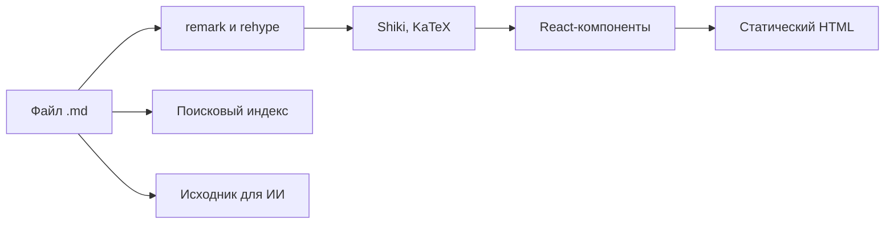

## Файлы

```
content/docs/          страницы в .md и .mdx
  meta.json            порядок и заголовки разделов
public/                картинки, иконка сайта и другая статика
components/            свои MDX-компоненты
theme.css              цвета и шрифты
wiki.config.ts         название, ссылки, маршруты, тексты интерфейса
src/                   ядро
  app/                 маршруты: страницы, поиск, /raw
  components/          интерфейс и встроенные MDX-компоненты
  lib/markdown/        пайплайн Markdown: плагины remark и rehype
  lib/source.ts        чтение контента и дерево навигации
```

## Ваше и ядро

Проект разделён так, чтобы ядро обновлялось одной командой и не задевало ваши файлы.

| Ваше             | Ядро                                    |
| ---------------- | --------------------------------------- |
| `content/`       | `src/`                                  |
| `public/`        | `next.config.ts`, `postcss.config.mjs`  |
| `components/`    | `tsconfig.json`                         |
| `theme.css`      | зависимости и скрипты в `package.json`  |
| `wiki.config.ts` |                                         |

Всё из правой колонки при [обновлении](../publishing/updating.md) заменяется новой версией. Если нужно поменять что-то в ядре, лучше предложить это в репозиторий шаблона.

## Как собирается страница



Всё это происходит при сборке, в браузер уходит готовая страница.
