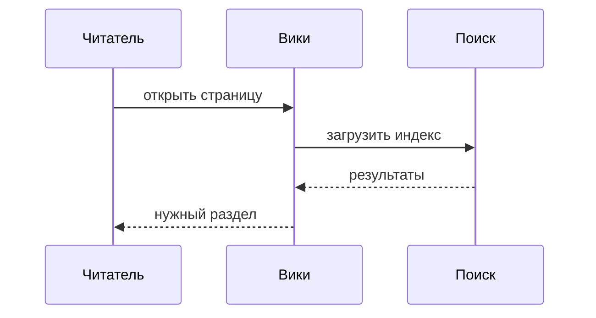
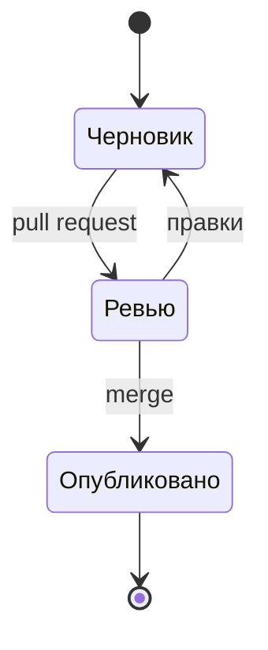

## Формулы

Инлайн-формулы пишутся между одиночными долларами: $E = mc^2$, а блочные между двойными.

```md
$$
\sum_{i=1}^{n} i = \frac{n(n+1)}{2}
$$
```

$$
\sum_{i=1}^{n} i = \frac{n(n+1)}{2}
$$

$$
\begin{aligned}
  \text{время чтения} &= \frac{\text{слов}}{\text{скорость}} \\
  &= \frac{1800}{200} = 9 \text{ мин}
\end{aligned}
$$

## Диаграммы

Блок кода с языком `mermaid` рендерится в схему и подстраивается под тему.

````md

````



